# PATHY

**An Android app for hikers: record a walk that survives a dead battery or a killed app, follow a trail turn by turn, and find real, current trails anywhere in the world.**

[](https://github.com/sami1507/pathy/actions/workflows/ci.yml)


| Discover (live OpenStreetMap data) | Recording, restored after the app was killed | Notification while recording | History, one outing waiting to upload |
|---|---|---|---|
| 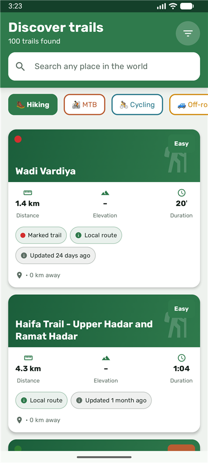 | 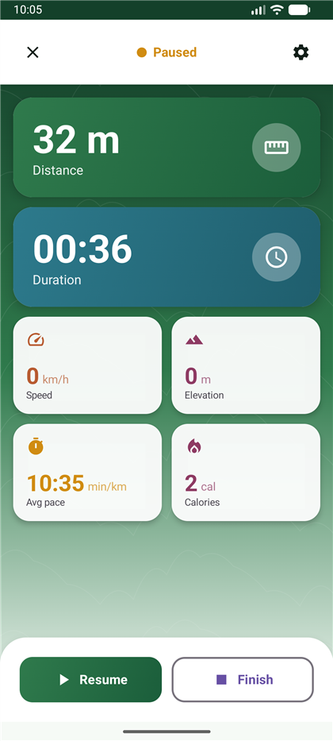 | 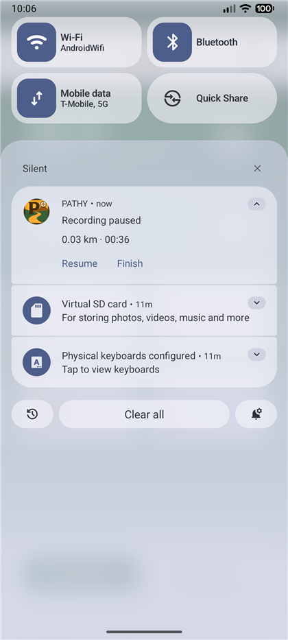 | 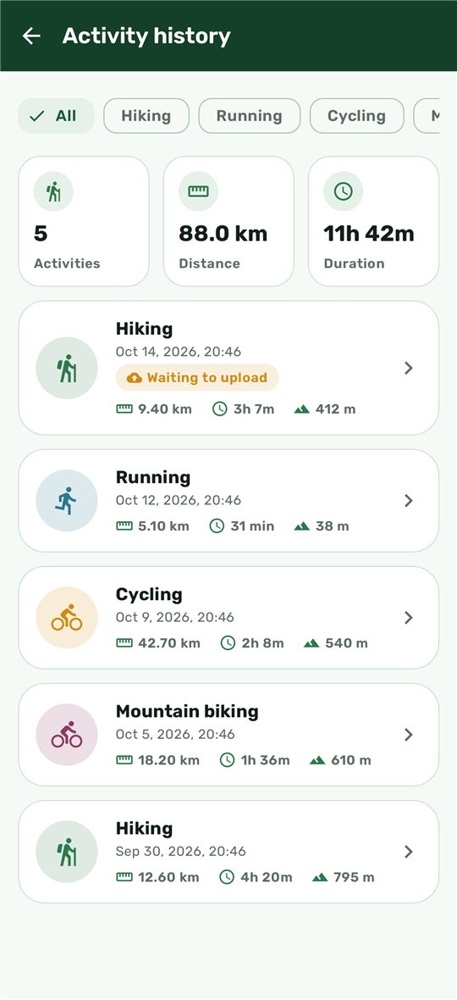 |

| Home | Trails in Arabic (right-to-left) | A post in Arabic | Composer in Hebrew |
|---|---|---|---|
| 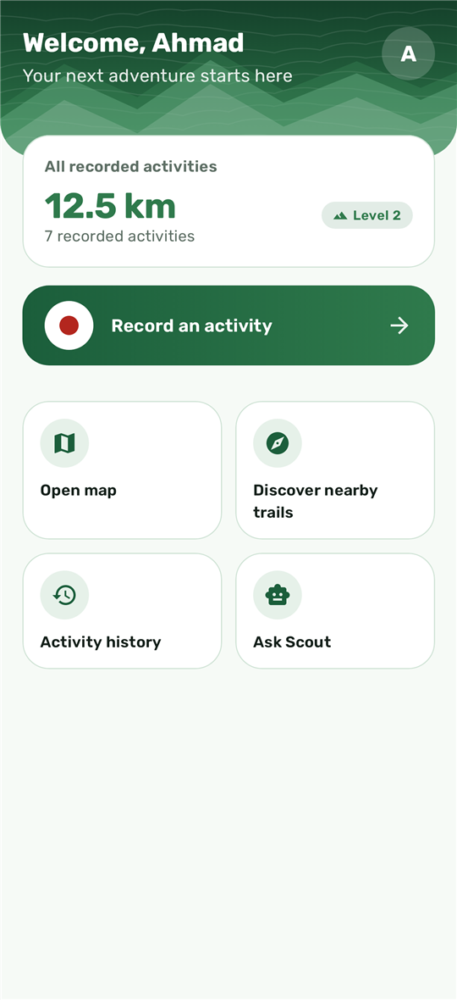 | 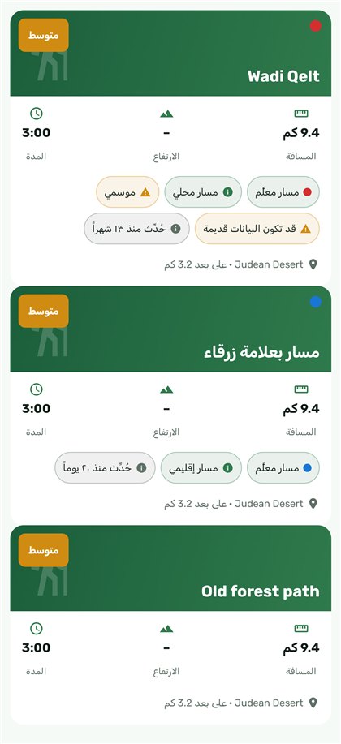 |  |  |

| Home in Arabic | Sign in | Sign in in Arabic | Settings, dark theme |
|---|---|---|---|
| 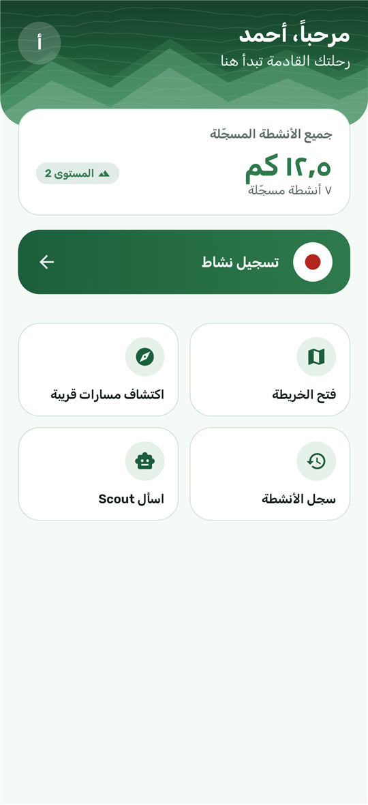 |  |  | 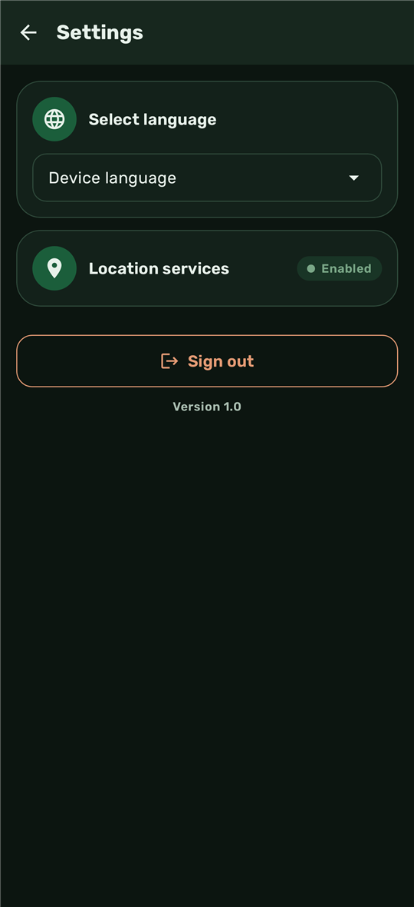 |

| Profile | Community | Saved trails, dark theme | Welcome |
|---|---|---|---|
| 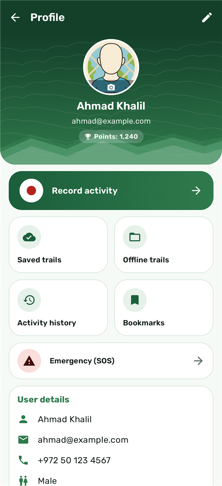 | 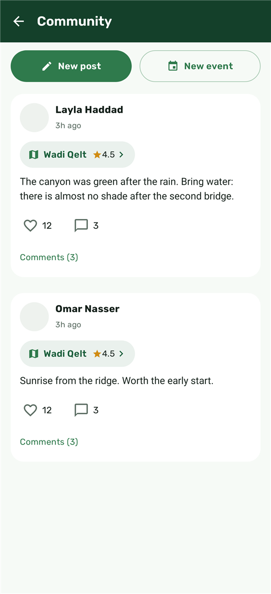 | 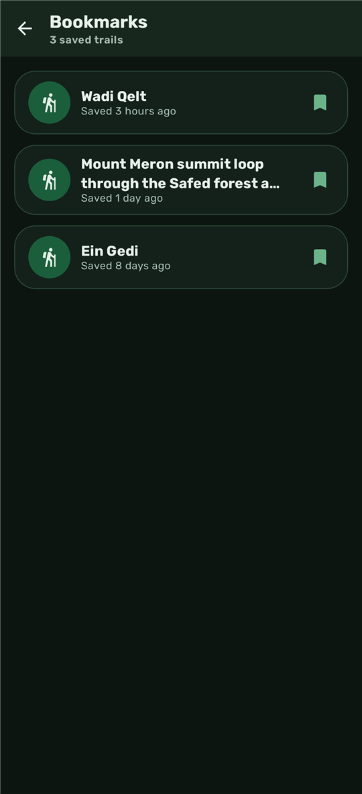 | 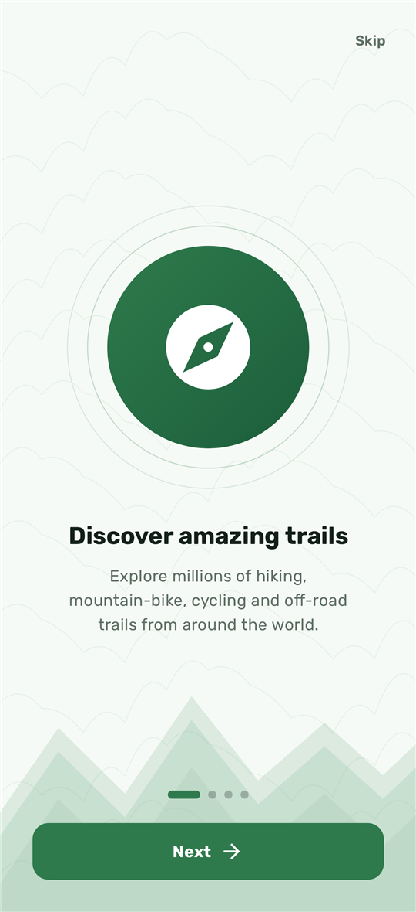 |

*The first three are from a real Android 17 emulator, the rest are rendered by the project's own screenshot tests.*

## What it does

- **Records walks reliably.** A foreground service writes every GPS point to a local database as it arrives. If Android kills the app, the walk comes back where it was, including a pause that was in progress. Finished walks upload when there is a connection.
- **Guides you along a trail.** Turns are worked out from the shape of the route (not from the compass), you can join the route anywhere, going off the trail is noticed and announced, and instructions are spoken once at the right distance.
- **Finds trails anywhere.** Search any place in the world, or look near you. Trails come from OpenStreetMap; the app stitches route relations into one line, grades difficulty, and **leaves out trails the data marks closed, abandoned, planned or private**. Marked routes without a name are recognised by their paint colour.
- **Tells you how much to trust a trail.** Each trail shows whether it is marked, seasonal, hard to follow, and how recently it was checked. Hikers can report "open / muddy / blocked / closed / not found" and the latest reports are shown on the trail.
- **Never invents numbers.** Climb comes from the map data or from real terrain elevation; when it is unknown the app says so.
- **Works offline.** Save the map around a trail with Mapbox offline storage; recordings are stored locally first; recent trail searches are cached on the phone.
- **Share and import.** Export a walk as GPX, or import a GPX file from any other app and follow it.
- **Community.** Posts with photos and comments, events, groups, a walkie-talkie (Nearby Connections without internet, WebRTC with it), emergency SOS by SMS, and Scout, an AI trail assistant that runs on a server so no API key ships in the app.
- **Speaks three languages**, including full right-to-left layouts: English, Arabic, Hebrew.

## Engineering highlights

| Area | What was done |
|---|---|
| **Architecture** | Domain logic lives in `:core`, a plain Kotlin module with no Android, Mapbox or Firebase types. The build keeps it that way, and it tests on any machine without secrets. |
| **Reliability** | Foreground service (`location` type) + Room + WorkManager. Recording survives process death; uploads retry with back-off; a finished walk is never lost to a bad connection. |
| **Data quality** | Overpass queries with mirrors, retries and a disk cache; relation stitching; availability and freshness assessment; place search; auto-widening search so a quiet area never shows an empty screen. |
| **Security** | No third-party API key in the APK (OpenAI, moderation and weather go through Cloud Functions). Firestore and Storage rules validate shape and size. A build refuses to embed a secret Mapbox token. See [SECURITY.md](SECURITY.md). |
| **Accessibility** | Touch targets of at least 48 dp on the main controls (asserted in tests), content descriptions, whole-card semantics for screen readers, layouts rendered at 200% font size, content-aware text direction for posts that mix languages. |
| **Testing** | 189 automated tests: GPS filtering, route following, OSM parsing against real Overpass data, Room migration, Firestore document format, navigation wording in all three languages, string parity, and screenshot tests in Arabic and Hebrew. |

## Architecture

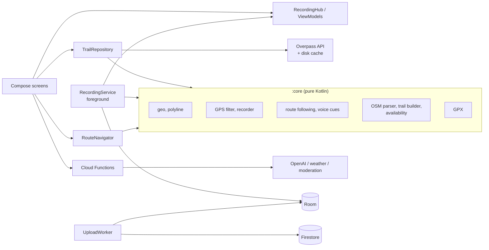

More detail in [docs/ARCHITECTURE.md](docs/ARCHITECTURE.md).

## Project layout

```
core/                 Android-free domain logic and its tests          (:core)
app/                  The Android app                                   (:app)
  tracking/           Recording service, Room entities, upload worker
  data/osm/           Overpass client, elevation, place search, trail repository
  data/conditions/    Hiker condition reports
  offline/            Offline map areas
  navigation/         Spoken and written guidance
  screens/ ui/        Compose screens and design system
  i18n/               Languages, fonts, right-to-left helpers
functions/            Firebase Cloud Functions (Scout AI, weather, moderation, reports)
firestore.rules       Database rules (validated shapes and sizes)
storage.rules         Storage rules
database.rules.json   Realtime Database rules (walkie-talkie switchboard)
docs/                 Architecture, trail data, security, walkie-talkie, localization
```

## Build and run

You can test the logic with no accounts and no secrets:

```bash
./gradlew :core:test
```

To build the app you need your own Firebase project and Mapbox tokens (the Mapbox SDK is downloaded with a secret token; the map uses a public one). Step by step in [docs/DEVELOPMENT.md](docs/DEVELOPMENT.md):

```bash
cp google-services.json.example app/google-services.json   # then fill in your Firebase values
# local.properties:  MAPBOX_DOWNLOADS_TOKEN=sk...   MAPBOX_PUBLIC_TOKEN=pk...
./gradlew :app:testDebugUnitTest :app:lintDebug :app:assembleDebug
```

## How "active trails" works (and what it cannot promise)

OpenStreetMap is edited by people, so no app can promise a trail is open today. PATHY does what the data allows: it hides trails marked closed, abandoned, under construction, planned or private; it warns about seasonal, hard-to-follow and long-unchecked trails and shows when each was last verified or edited; and it lets hikers on the ground report the current condition. Details and limits: [docs/TRAIL_DATA.md](docs/TRAIL_DATA.md).

## Known limitations

- The walkie-talkie over the internet uses STUN only, so it cannot connect phones behind strict NATs without a TURN server. Only one phone enforces "one speaker at a time".
- Live location sharing between group members is not shipped: it needs rules that check group membership.
- The recording service and trail discovery were exercised on an emulator. Offline map download, the walkie-talkie and the Firestore rule changes (deployed separately with `firebase deploy`) still need testing on real devices and accounts.

## License

The code is released under the [MIT License](LICENSE). The Rubik font is used under the SIL Open Font License (see `app/src/main/assets/licenses/Rubik-OFL.txt`). Trail data is © OpenStreetMap contributors, available under the [ODbL](https://www.openstreetmap.org/copyright).

## Status

Actively developed by [@sami1507](https://github.com/sami1507). Feedback and issues are welcome.
